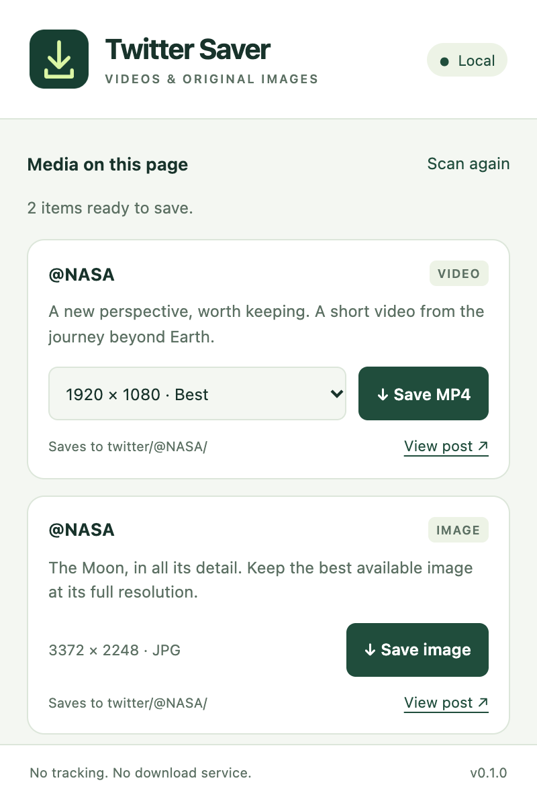
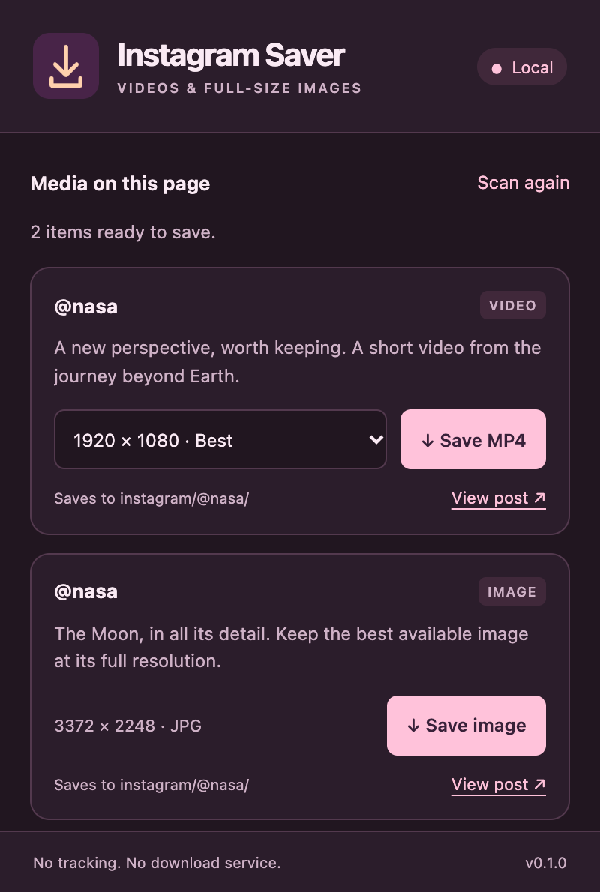

# Local Browser Plugins

A collection of small, auditable Chrome extensions. Each plugin installs independently and runs entirely from local source: no remote code, tracking, download servers, or automatic updates.

| Plugin                                           | What it saves                                            | Download folders                        | Install directory                  |
| ------------------------------------------------ | -------------------------------------------------------- | --------------------------------------- | ---------------------------------- |
| [tw-downloader](plugins/tw-downloader/README.md) | X/Twitter images, MP4 videos, GIF posts                  | `Downloads/twitter/@original_poster/`   | `plugins/tw-downloader/extension/` |
| [ig-downloader](plugins/ig-downloader/README.md) | Instagram photos, reels, MP4 videos, and mixed carousels | `Downloads/instagram/@original_poster/` | `plugins/ig-downloader/extension/` |
| [rd-downloader](plugins/rd-downloader/README.md) | Reddit images, galleries, and videos with audio          | `Downloads/reddit/@username/`           | `plugins/rd-downloader/extension/` |

All plugins provide compact hover/focus download icons that don't shift posts, separate controls for album items, and a light/dark toolbar popup with video quality choices. They use the post's own author metadata rather than the profile you're browsing; unknown handles go into `@unknown`.

<p>
  
  
</p>

## Install a plugin

1. Clone or download this repository and open `chrome://extensions` in Chrome.
2. Enable **Developer mode**, click **Load unpacked**, and select the plugin's `extension/` directory from the table above.
3. Pin its icon, then refresh the matching website's tabs once.
4. Hover over media to save it, or open the toolbar popup to choose a video quality.

No build step or account setup is needed to load the checked-in extensions. Normal access to each website still applies. Review changes before updating local source, then reload the extension and refresh its website tabs. Instagram's signed media links can expire; refresh the post to detect fresh links.

Reddit videos combine separate audio and video tracks locally with bundled MP4Box.js. See its [guide](plugins/rd-downloader/README.md) for permissions and supported formats.

The root `extension/` symlink preserves the original Twitter installation path on systems with symlink support. New installations should use `plugins/tw-downloader/extension/`. The GitHub repository URL remains unchanged.

## Repository layout

```text
plugins/
  tw-downloader/       # Twitter extension, tests, screenshots, and guide
  ig-downloader/       # Instagram extension, tests, screenshots, and guide
  rd-downloader/       # Reddit extension, local MP4 muxer, tests, and guide
shared/                # Popup HTML, JavaScript, and CSS source
scripts/               # Collection build, checks, icons, previews, packaging
```

Each `extension/` directory is self-contained. Generated popup files and MAIN-world parser copies are checked in so Chrome can load a plugin directly. Edit `shared/popup.*` for common UI changes and each plugin's `media.js`, `content.js`, and `site.js` for platform behavior; run the build afterward. Checks reject generated-file drift and extra permissions or update mechanisms.

## Development

Run from the repository root with Node.js 22+ and npm:

```sh
npm ci --ignore-scripts
npm run build                      # Synchronize all plugins and bundle the Reddit muxer
npm test                           # All parser, authorization, and muxer suites
npx playwright install chromium    # One-time isolated test browser install
npm run test:browser                # All loaded-extension browser suites
npm run check                      # Permission boundaries, generated files, syntax, formatting
npm run format                     # Format source and synchronize plugins
node scripts/icons.mjs             # Regenerate packaged icons
node scripts/preview.mjs            # Regenerate all plugins' UI previews
npm run package                    # Create one ZIP per plugin in dist/
```

Build, icon, preview, and package commands also accept a plugin ID, for example `npm run package -- ig-downloader` or `node scripts/preview.mjs tw-downloader`. Packaging requires the `zip` command. Archives contain only the selected extension's local runtime files.

Tests use authored fixtures and temporary Chromium profiles, not personal accounts. Live checks and platform limitations are documented in each plugin's guide. Do not commit account responses, cookies, downloaded personal media, or signing keys. For a new plugin, add a directory under `plugins/`, register its exact site matches in `scripts/plugins.mjs`, and include parser, download-boundary, and browser tests.
