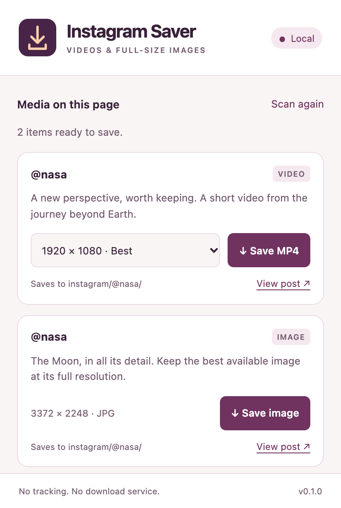

# ig-downloader

A local Chrome extension for Instagram photos, reels, MP4 videos, and mixed carousels. It uses the same compact controls and light/dark popup as [tw-downloader](../tw-downloader/README.md), with a distinct purple icon.

<p>
  
  
</p>

## Install and use

Open `chrome://extensions`, enable **Developer mode**, choose **Load unpacked**, and select `plugins/ig-downloader/extension/` from the repository root. Pin **Instagram Media Saver** and refresh Instagram once.

Hover over a post image or reel to reveal its download icon. Keyboard focus also reveals controls; touch devices show them directly. Carousels get a control for each rendered item. Use the toolbar popup to see the detected items and select a video quality. Downloads save automatically into:

```text
Downloads/instagram/@original_poster/
```

The author comes from the media's `user` or `owner` metadata. Carousel children inherit the parent post's author. Repost wrappers don't replace the original author's identity, and browsing someone else's profile doesn't change attribution. If no handle is available, the folder is `@unknown`.

Images use the highest-resolution candidate Instagram actually delivers, preserving JPG, PNG, WebP, or AVIF format. This is not a guarantee of the uploader's original, uncompressed file. Existing files receive numeric suffixes instead of being overwritten.

## Detection and limits

The plugin observes Instagram's own fetch/XHR responses and JSON hydration scripts. It supports current feed/media objects (`image_versions2`, `video_versions`, `carousel_media`) and GraphQL image, video, and sidecar shapes. Signed CDN URLs are preserved, including their query strings; it does not construct undocumented download API requests or copy credentials.

The catalog holds up to 150 media records in memory and clears on navigation or tab close. The popup lists posts present in the current page, while on-media controls match validated image/video assets. It doesn't download avatars, preview cards, video cover images as photos, or arbitrary URLs supplied by a page.

This version supports posts, reels, and carousels. Stories, live broadcasts, DRM, and DASH/HLS-only media aren't supported. Videos need a complete MP4 variant; partial range URLs are rejected. Instagram can change its response format or expire media URLs. Refresh the post, play the reel or browse the carousel, then scan again if detection is incomplete. It uses only content your normal session can access.

## Permissions and validation

The only API permission is `downloads`. Content scripts run only on HTTPS `instagram.com` and `www.instagram.com`. Download URLs must be HTTPS media files on subdomains of Instagram's `cdninstagram.com` or Meta's `fbcdn.net`; lookalike hosts, credentials in URLs, scripts, and executable formats are rejected.

Page events can populate the catalog but cannot start downloads. Only real clicks send requests, and the background worker checks the sending extension, top-frame website or popup, URL, IDs, and filename again. There are no runtime dependencies, tracking endpoints, persistent extension storage, remote code, or update URLs.

## Development and verification

Use the [collection's root commands](../../README.md#development). This plugin's tests live in `plugins/ig-downloader/tests/` and cover ownership, mixed albums, media sorting, CDN validation, signed URLs, failed downloads, XHR/fetch/Relay detection, malicious messages, SPA updates, and zero layout shift.

The checked-in `page-media.js` and `popup.*` files are generated by `npm run build`. Edit `media.js` for extraction and validation, `content.js` for Instagram DOM matching, and `site.js` for popup configuration. Edit `shared/popup.*` at the repository root for common UI changes.

Browser fixtures verify the loaded extension and its Chrome download boundary. They don't prove that every live Instagram layout or post format is supported. Never save personal account payloads as fixtures.

Extraction reference: [yt-dlp's Instagram extractor](https://github.com/yt-dlp/yt-dlp/blob/master/yt_dlp/extractor/instagram.py).

## Live verification

On October 26, 2026, the extension was installed and tested in Chrome against public NASA media:

| Post                                                     | Saved file                      | Result                                                                            |
| -------------------------------------------------------- | ------------------------------- | --------------------------------------------------------------------------------- |
| [Photo](https://www.instagram.com/p/De53dIfl0QR/)        | 1280 × 1600 JPG, 92,565 bytes   | Downloaded through the popup; image dimensions verified                           |
| [Reel](https://www.instagram.com/nasa/reel/DeTUk4sDSp-/) | 718 × 1276 MP4, 3,194,416 bytes | Downloaded through the compact overlay; H.264 video and AAC audio tracks verified |

Both files landed in `Downloads/instagram/@nasa/`. The 43.829-second reel decoded frames and sought to one second before the end without errors. Detection on NASA's profile also preserved other media owners' handles, including `nasawebb` and `nasdaq`. These checks cover the listed live posts; other shapes and layouts use the automated fixtures above.
