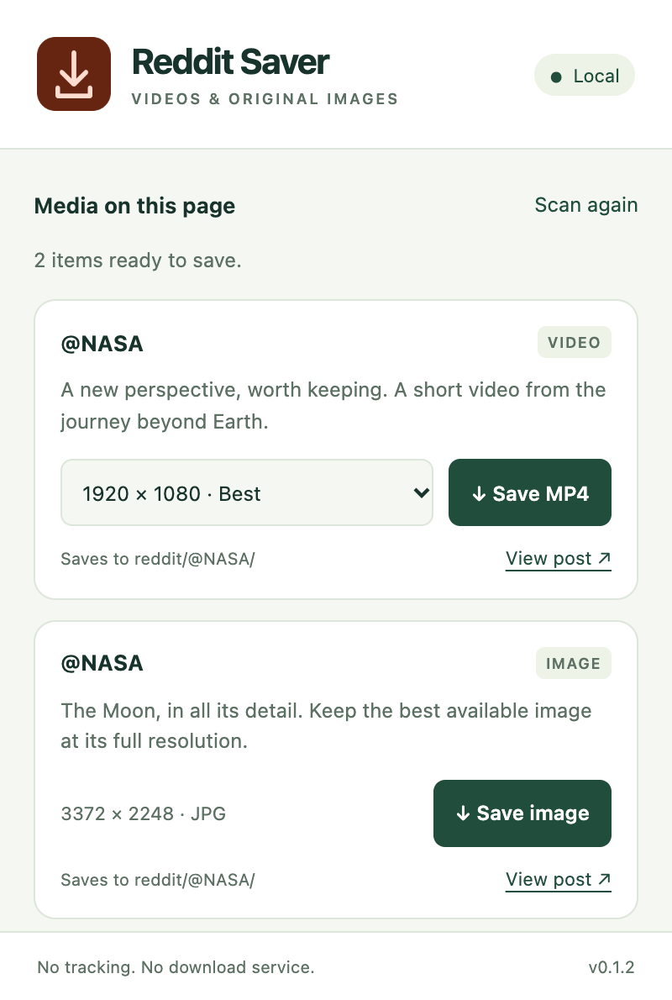
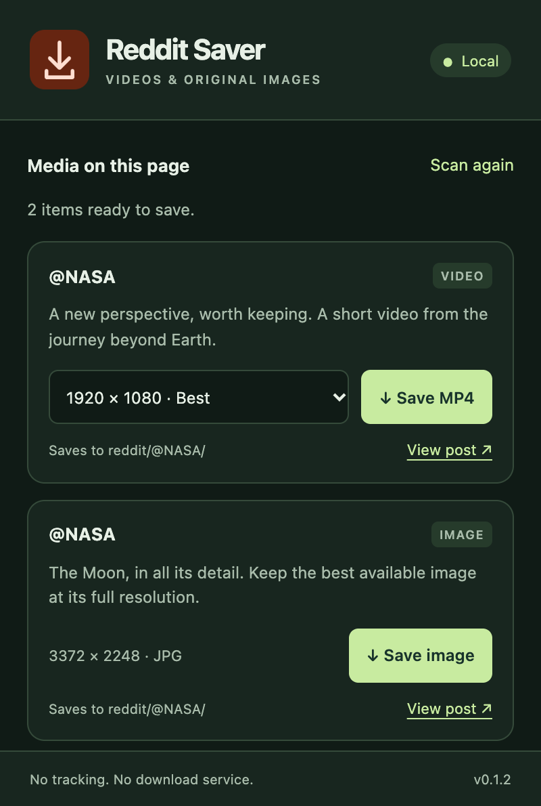
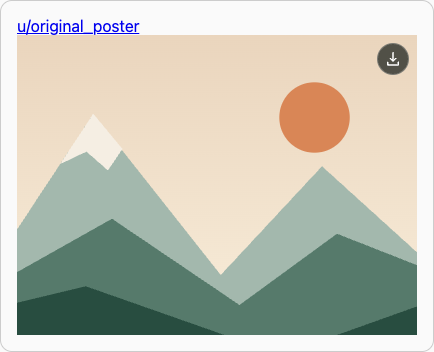
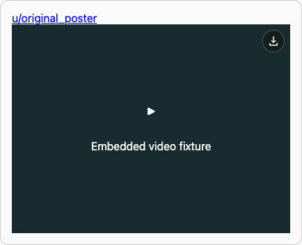

# rd-downloader

A local Chrome extension that adds download buttons directly to Reddit images, galleries, and hosted videos, and Redgifs embeds. Uses the collection's compact hover/focus controls and light/dark popup.

## Install and use

In `chrome://extensions`, enable **Developer mode**, select **Load unpacked**, and choose `plugins/rd-downloader/extension/`. Pin **Reddit Media Saver**, then refresh Reddit.

Video download icons stay visible at the top right of the player, including lazy and embedded players. Hover over an image to reveal its download icon. Gallery items get individual buttons. Keyboard focus reveals image buttons; touch devices show them directly. The popup lists detected media and any available video variants. Files save to your configured Chrome download directory:

```text
reddit/@username/reddit_<post-id>_<media-id>[_<width>x<height>].jpg
reddit/@username/reddit_<post-id>_<media-id>[_<width>x<height>].mp4
```

The username comes from the post, not the profile or subreddit being browsed. Crosspost JSON preserves the original author's name; DOM-only detection uses the author exposed by the rendered post. Deleted or unavailable authors use `@unknown`. Existing files get numeric suffixes.

<p>
  
  
</p>



## Media support

- Reddit-hosted images, including original `i.redd.it` images, galleries, and GIF images. Preview links are mapped to their original Reddit image IDs where available.
- Reddit-hosted MP4 videos, including ordinary and fragmented MP4 tracks. Separate DASH video and audio files are combined locally into one MP4 without re-encoding. A failed audio request reports an error instead of silently saving a muted clip.
- Silent clips whose valid DASH playlist has no audio, and animated image MP4s, including signed `.gif?format=mp4` files on Reddit preview hosts.
- Redgifs watch/iframe links and direct MP4s on Redgifs media hosts. On click, the plugin requests anonymous temporary API access and resolves the highest available complete MP4. It keeps the Reddit author for the destination folder and avoids substituting Reddit's shorter or silent preview.
- Direct `i.imgur.com` images, GIFs, MP4s, and GIFV links. GIFV is saved as its underlying MP4; original GIF files retain `.gif`.
- Modern Reddit post/player elements and open shadow-root galleries, plus expanded media on old Reddit. Redgifs embed attributes and supported post destinations allow controls to appear before an iframe or player loads, including closed shadow-root embeds. Controls sit above the player's layout so named slots cannot hide them, and follow scrolling and resizing. Detection uses rendered attributes, JSON hydration, and Reddit's own fetch/XHR responses; it makes no additional post-API requests.

Video assembly fetches the selected media and its DASH playlist only after a download click. It uses the selected complete MP4 or the best complete representation when a player exposes only a manifest/container URL. Audio is selected from the same video's playlist. The popup can offer only the qualities exposed in captured metadata; it does not fetch playlists during browsing.

Other external video services, live streams, DRM, HLS-only streams, segmented playlists without complete MP4 resources, multi-period DASH, and comment attachments are not supported. Each track is limited to 128 MB because assembly occurs in memory. Reddit can change its markup or expire links; refresh the post and try again when that happens.



## Permissions and local processing

Content scripts run only on HTTPS `reddit.com`, `www.reddit.com`, `old.reddit.com`, and `new.reddit.com`. Permissions are `downloads`, `offscreen`, and host access to **only** `https://v.redd.it/*` and `https://api.redgifs.com/*`. The offscreen document creates the combined MP4 blob; Chrome downloads it. Video requests omit credentials and reject redirects. The Redgifs anonymous token is held only in service-worker memory and refreshed once on expiry. No account credentials, cookies, remote code, download services, telemetry, or persistent extension storage are used. Reload the unpacked extension after updating to v0.1.2, then refresh the Reddit tab to inject the updated controls. Reloading the extension alone does not update scripts already running in the tab.

The worker validates sender identity, top-frame origin, media IDs, selected URLs, and generated filenames. Page events can add validated media to the catalog but cannot trigger downloads. Only trusted user clicks activate controls. MP4Box.js 2.5.0 is bundled locally under BSD-3-Clause; its license ships with the extension. The Twitter and Instagram permission sets remain unchanged.

## Development and verification

Use the [root development commands](../../README.md#development). Build from `media.js`, `content.js`, `observer.js`, `redgifs.js`, and `src/mux.js`; `page-media.js`, `mux.js`, and `popup.*` are generated and checked in. Dependency versions and their integrity hashes are pinned in the root lockfile.

```sh
npm run build
node --test plugins/rd-downloader/tests/*.test.cjs
npx playwright test plugins/rd-downloader/tests/browser
npm run check
npm run package -- rd-downloader
```

Deterministic tests cover media extraction, original-author attribution, galleries, URL boundaries, download failures, navigation, open shadow roots, native offscreen creation, and Chrome saving a locally combined MP4 with both tracks. Playwright cannot route hidden offscreen network requests, so the download test runs the same packaged offscreen document in a routable extension tab; native offscreen creation is tested separately. MP4 tests compare every output sample against the authored source tracks, including fragmented input. Redgifs tests cover iframe and popup controls, closed shadow-root embeds, named slots, unloaded players, scrolling/resizing, token refresh, host validation, error handling, and no API requests before a click. GIF tests cover MP4-backed previews, original animations, and galleries. Fixtures contain generated test patterns and a sine tone, not personal media.

Live Reddit returned HTTP 403 for the reported post, and connected browser access was unavailable. The Redgifs temporary-access endpoint returned HTTP 200 with a token. Authored fixtures verify clip resolution and download requests; the reported live clip and authenticated Reddit rendering remain unverified.

References: [Reddit video model](https://developers.reddit.com/docs/api/redditapi/models/type-aliases/RedditVideo), [Redgifs extractor reference](https://github.com/yt-dlp/yt-dlp/blob/master/yt_dlp/extractor/redgifs.py), [MP4Box.js](https://github.com/gpac/mp4box.js), [Chrome offscreen API](https://developer.chrome.com/docs/extensions/reference/api/offscreen).
