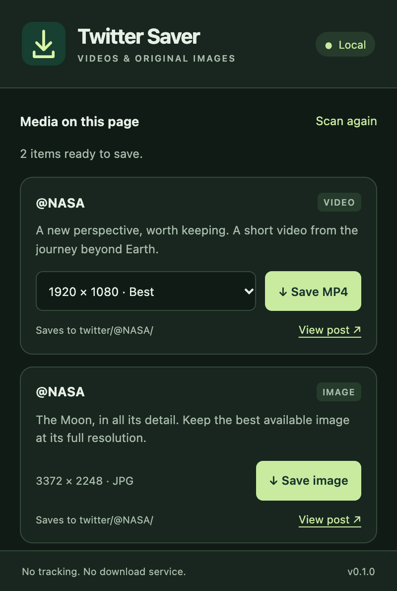

# In-house Twitter Media Saver

A small Chrome extension that saves MP4 videos, GIF posts, and original-size images from X/Twitter. Every line of runtime code lives in `extension/`. There are **no runtime dependencies, download servers, analytics, or automatic update URLs**.

<p>
  
  
</p>

The popup follows your system's light or dark appearance. The toolbar and popup share a packaged download icon; no external fonts, images, or UI libraries are loaded. Preview images use authored sample content.

## Install locally

1. Open `chrome://extensions` in the Chrome profile you use for X.
2. Enable **Developer mode**.
3. Click **Load unpacked** and select this repository's **`plugins/tw-downloader/extension/`** directory.
4. Pin **In-house Twitter Media Saver** using Chrome's extensions menu.
5. Refresh any X/Twitter tabs that were already open.

No account, API key, terminal command, or build step is needed to use it. Keep the extension directory in place; Chrome loads its files from there. This unpacked installation has no Web Store update source. To update, review local changes, click **Reload** on the extension card, and refresh X.

## Save a video or image

Browse X normally. Hover over an image or video to reveal a small download icon in its upper-right corner. The icon sits over the media and adds no space to the post; keyboard focus reveals it too, and touch devices show it directly. Video icons save the highest available MP4 quality; image icons request the original-size JPG, PNG, or WebP. Albums have a separate icon on each image. A brief checkmark confirms that Chrome accepted the download.

Alternatively, open the toolbar popup to save images or choose a resolution for a video. Downloads save automatically under your Chrome Downloads directory in `twitter/@original_poster/`, for example `Downloads/twitter/@NASA/twitter_NASA_…_1920x1080.mp4`. Chrome handles download progress, cancellation, and retries.

For retweets, attribution comes from the nested original post, not the account that reposted it. Quoted videos keep their own post's author. If X doesn't provide the author's handle, the file goes into `twitter/@unknown/` rather than guessing from the profile you're browsing. Folder and file names are sanitized, and existing files receive a numeric suffix instead of being overwritten.

The popup lists images and videos from posts currently rendered on the page, including quoted posts. **Scan again** refreshes that list; it does not contact a download service. Filenames include the author, post ID, media ID, and resolution when available. Images retain their format rather than being renamed to a different file type. Profile pictures, preview cards, and video thumbnails are excluded.

### If a video doesn't appear

Refresh X once after installation or an extension reload. Scroll to the video and play it, then scan again. The extension detects MP4 variants in the responses X already loads; it cannot recover responses sent before it started. It does not bypass login, protected-post access, or other access restrictions.

Live streams, DRM, and HLS-only playlists are not supported in this version. Some posts may provide streaming formats without downloadable MP4 variants. X can change its response format, so detection may require a local update. Seeing “Download started” means Chrome accepted the download; check Chrome's downloads for the final result.

## Permissions and data flow

| Access                                                                 | Purpose                                                                                                                                      |
| ---------------------------------------------------------------------- | -------------------------------------------------------------------------------------------------------------------------------------------- |
| `downloads`                                                            | Save user-requested videos and images into author subfolders. Chrome's permission also exposes download history; this code never queries it. |
| Content scripts on HTTPS `x.com`, `twitter.com`, and their `www` hosts | Read media metadata from X's own API responses and add save controls. No other websites receive scripts.                                     |

The MAIN-world observer wraps `fetch` and XHR without changing requests or response bodies delivered to X. It passes only normalized media metadata into an isolated content script. Because page events can be forged, the isolated script and background worker validate data again. Downloads accept only exact HTTPS `video.twimg.com` MP4 URLs or JPG/PNG/WebP images under `pbs.twimg.com/media/`; IDs and filenames are constrained. SVG and executable formats are rejected. Page messages cannot start downloads. Inline downloads require a real click, and the worker accepts messages only from this extension's popup or top-frame X content script.

Up to 150 media records are held in memory per tab; there is no persistent extension storage. Refreshing or closing the tab clears that catalog. No cookies, tokens, passwords, or request headers are read by this code. Downloads contact Twitter's media CDN directly through Chrome; normal browser network metadata still applies. This extension does not guarantee that every file or future local modification is safe.

## Development

Run the commands below from the [collection repository root](../../README.md), with Node.js 22 or newer and npm. Development tools are version-pinned in `package-lock.json`; none are included in the extension.

`page-media.js` is a checked-in, identical copy of `media.js` for the MAIN execution world. Chrome deduplicates injected script paths across worlds, so the two worlds need separate file paths. Edit `media.js` and run `npm run build` (also included in `npm run format`) to synchronize the copy. `npm run check` detects drift. Icons are checked in too; regenerate them with `node scripts/icons.mjs` after installing test Chromium.

`plugins/tw-downloader/extension/icon.svg` is the editable icon source. Run `node scripts/preview.mjs tw-downloader` to regenerate the light and dark documentation screenshots from the real popup with network access blocked.

```sh
npm ci --ignore-scripts
npm run build                    # Sync the checked-in MAIN-world parser copy
npm test                         # Parser and download authorization tests
npm run check                    # Manifest boundaries, syntax, formatting
npx playwright install chromium  # One-time isolated test browser install
npm run test:browser              # Actual extension with synthetic X responses
npm run format                   # Format source, excluding AGENTS.md
npm run package                  # Create dist/tw-downloader-0.1.0.zip + print hash
```

`npm run package` requires the `zip` command (included on macOS). The archive contains only extension files. Extract it before using **Load unpacked**.

| Path                      | Responsibility                                                     |
| ------------------------- | ------------------------------------------------------------------ |
| `extension/media.js`      | Pure tweet extraction, URL validation, quality ordering, filenames |
| `extension/observer.js`   | Observe fetch/XHR responses and replay a bounded metadata cache    |
| `extension/content.js`    | Isolated catalog and inline controls, including SPA updates        |
| `extension/background.js` | Validate requests and start Chrome downloads                       |
| `extension/popup.*`       | Video list, quality selection, empty/error states                  |
| `tests/`                  | Node tests and isolated Chromium integration tests                 |
| `scripts/`                | Manifest/syntax checks and packaging                               |

Use two-space indentation and run Prettier before submitting changes. Add regression fixtures when extraction changes. Never commit real account responses, session data, or downloaded personal media. Review any new permission, network destination, dependency, or update mechanism carefully. Test browser fixtures exercise the extension plumbing; they do not establish compatibility with every live X post.

API references: [Chrome content scripts](https://developer.chrome.com/docs/extensions/reference/manifest/content-scripts), [downloads](https://developer.chrome.com/docs/extensions/reference/api/downloads), and [local installation](https://developer.chrome.com/docs/extensions/get-started/tutorial/hello-world#load-unpacked).

## Live verification

On October 25, 2026, the unpacked extension was installed in Chrome and tested against a [public NASA video post](https://x.com/NASA/status/2113776971603689874). The inline button downloaded the 1920 × 1080 MP4 (21,138,063 bytes). The popup exposed four quality choices and downloaded the selected 1280 × 720 MP4 (10,238,348 bytes). Both saved files decoded frames, reported a 59.893-second duration, and successfully sought to one second before the end without media errors. QuickTime identified H.264 video and 48 kHz AAC audio in the 1080p file. A follow-up live test verified automatic creation of `Downloads/twitter/@NASA/` with no save dialog; the saved 1080p file's SHA-256 matched the previously verified video. This live check covers one public post; retweet attribution and other extraction cases are covered by synthetic fixtures.

The compact video overlay was also tested live. On a [NASA photo post](https://x.com/NASA/status/2114484649430798432), both the on-image icon and popup saved the original 3372 × 2248 JPG (688,628 bytes) into `twitter/@NASA/`; their SHA-256 hashes matched. Browser regression tests compare post and next-post geometry before and after control injection and downloading, covering both videos and photo albums without layout shifts.

The shared popup source now lives in `shared/popup.*` at the collection root. Run `npm run build` after editing it. The root `extension/` compatibility symlink preserves existing macOS Twitter installations; new installations should use the plugin directory above.
